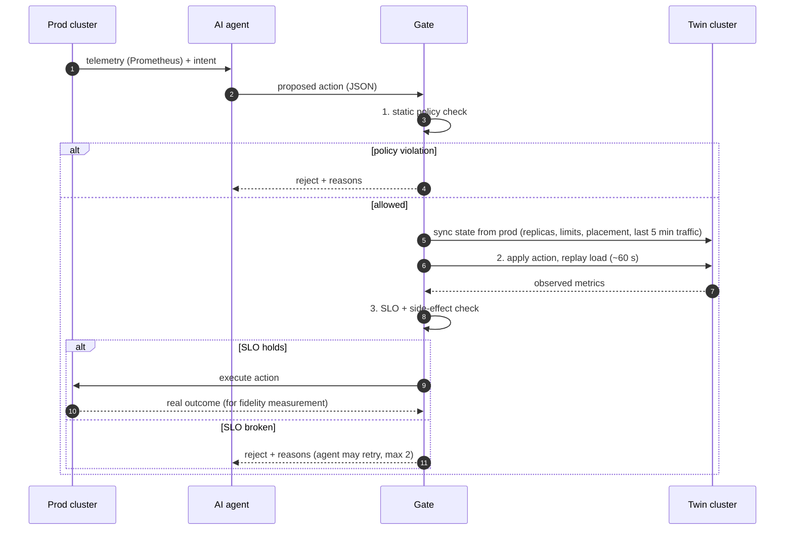

# Architecture

## The loop



## Stages

| Stage | What it checks | Today | Planned |
|---|---|---|---|
| 1. Policy | Protected namespaces, replica bounds, allowed nodes | `ndt_gate.policy` (Python rules) | Kyverno or OPA/Gatekeeper |
| 2. Twin test | What the action actually does under realistic load | `StubTwin`, a toy capacity model | Second Kubernetes cluster synced from prod, traffic replay |
| 3. SLO check | p95 latency, error rate, failed/pending pods, CPU headroom, **for every service**, not just the target | `ndt_gate.slo` | Same checks, inputs from PromQL |

The SLO check looks at every service on purpose: the unsafe actions this project
cares about are often fine for the target and bad for a neighbour.

## Mapping to ETSI ZSM

The gate sits between *decision* and *actuation* in the ZSM closed loop
(ZSM 009-1 / ZSM 018). The twin is a validation step inside the loop rather than
a separate planning tool. Full write-up in the thesis.

## Action schema

```json
{
  "type": "scale | migrate | recover",
  "namespace": "service-chain",
  "target": "processor",
  "params": { "replicas": 4 },
  "rationale": "free text from the agent, logged for audit"
}
```

`scale` needs `params.replicas`, `migrate` needs `params.to_node`, `recover` needs nothing.
